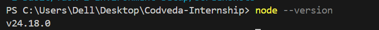
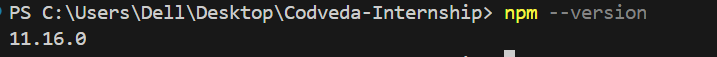
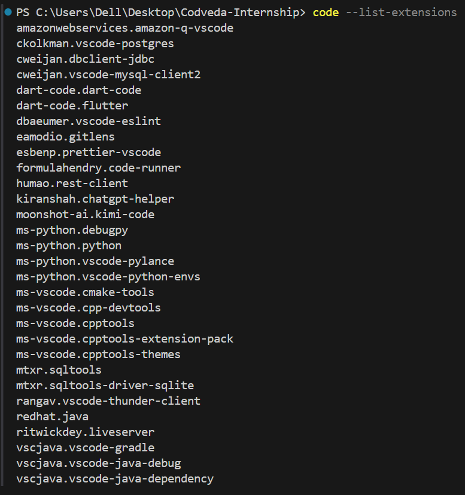
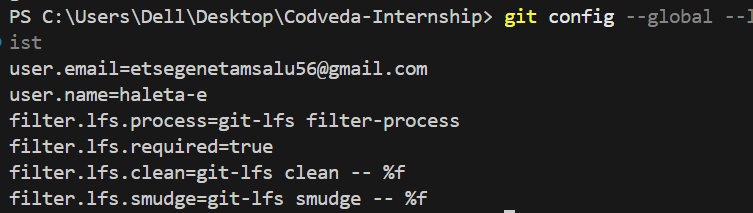
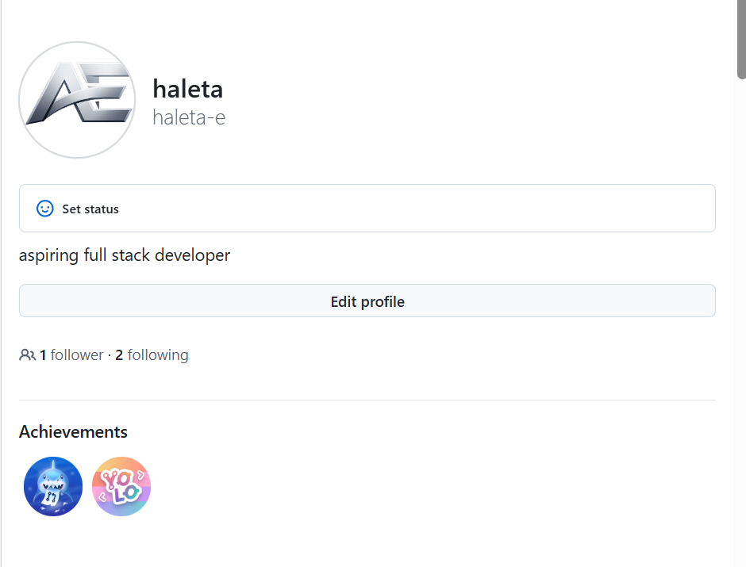
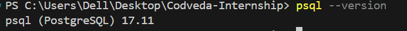
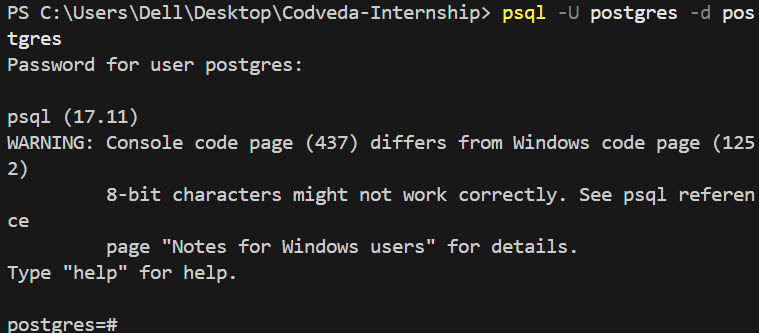
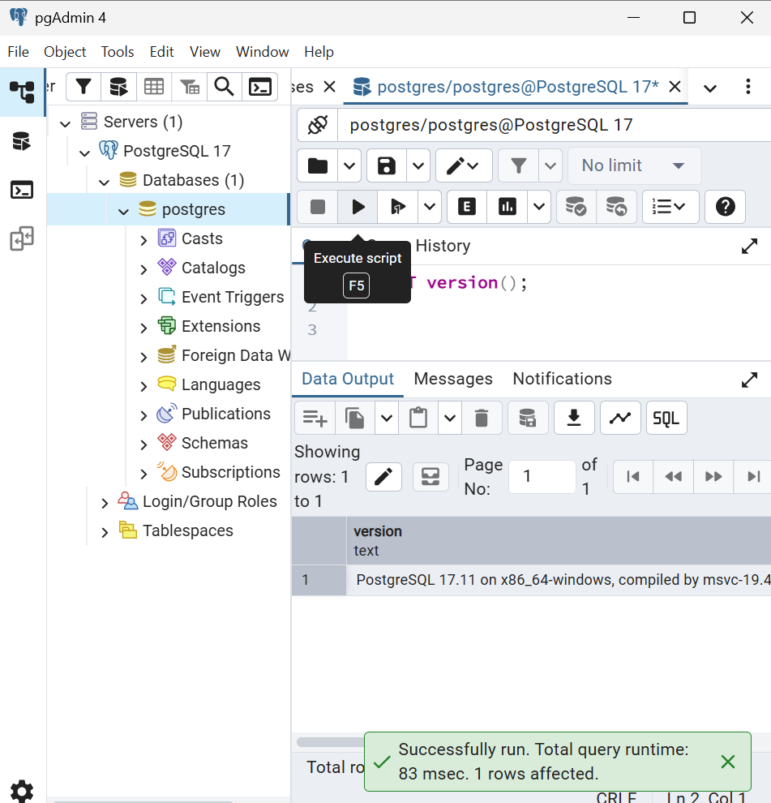
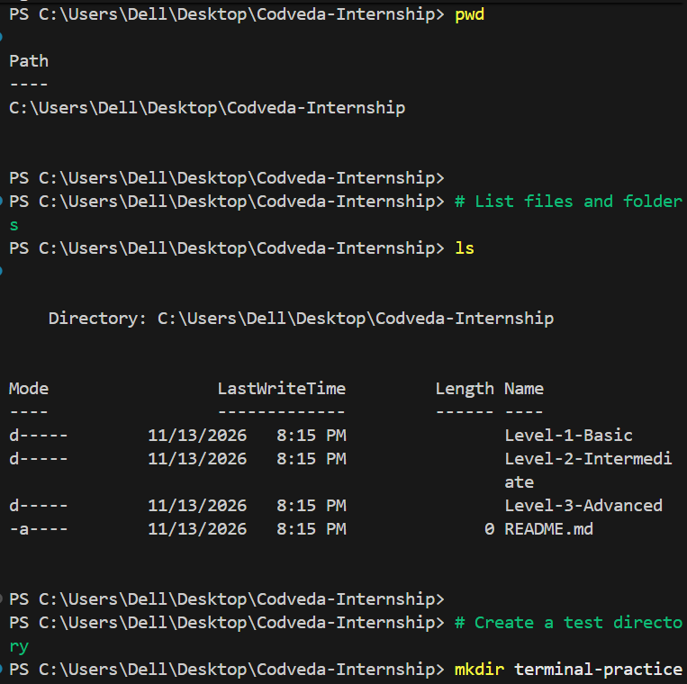

# Task 1: Development Environment Setup

## 1. Introduction

The purpose of this task was to prepare a development environment for full-stack web development.

The setup involved installing and configuring the essential development tools required to build, test, and manage web applications.

The main tools configured during this task include:

- Node.js
- npm (Node Package Manager)
- Visual Studio Code
- Git
- GitHub
- PostgreSQL
- pgAdmin 4
- Windows PowerShell

These tools provide the foundation for developing server-side applications, managing source code, working with databases, and executing development commands.

## 2. Development Tools Installed

The following tools were installed or configured as part of the development environment.

| Tool | Purpose | Status |
|---|---|---|
| Node.js | JavaScript runtime for server-side development | Completed |
| npm | Manages JavaScript packages and dependencies | Completed |
| Visual Studio Code | Code editor | Completed |
| Git | Version control system | Completed |
| GitHub | Online repository hosting | Completed |
| PostgreSQL | Relational database management system | Completed |
| pgAdmin 4 | Graphical interface for PostgreSQL | Completed |
| Windows PowerShell | Command-line environment | Completed |

*Note: Only mark a tool as completed after verifying that it works.*

## 3. Node.js and npm Configuration

### 3.1 Node.js Installation

Node.js was installed to provide a JavaScript runtime environment.

It allows JavaScript code to execute outside a web browser and is required for developing backend applications using frameworks such as Express.js.

### 3.2 npm Configuration

npm (Node Package Manager) was installed together with Node.js.

It is used to install, update, and manage project dependencies and development packages.

### 3.3 Installation Verification

The installation was verified using Windows PowerShell.

Commands executed:

```powershell
node -v
npm -v
```

The commands returned the installed versions successfully.

**Installed versions:**

- Node.js: [Enter your actual version]
- npm: [Enter your actual version]

### 3.4 Evidence





## 4. Visual Studio Code Configuration

### 4.1 Installation

Visual Studio Code was installed as the primary code editor for development.

It provides features such as syntax highlighting, an integrated terminal, debugging support, and extension management.

### 4.2 Extensions Installed

The following extensions were installed or checked in Visual Studio Code.

| Extension | Purpose |
|---|---|
| Prettier | Formats source code consistently |
| ESLint | Identifies JavaScript coding problems |
| REST Client | Allows HTTP requests to be tested inside VS Code |
| PostgreSQL | Provides PostgreSQL-related database tools |
| GitLens | Provides Git history and repository insights |

### 4.3 Configuration Verification

The Extensions panel in Visual Studio Code was used to verify the installed extensions.

The integrated terminal was also checked to confirm that development commands could be executed directly inside the editor.

### 4.4 Evidence



## 5. Git and GitHub Configuration

### 5.1 Git Installation

Git was installed to manage source code changes and maintain the development history of projects.

Git allows developers to track modifications, create commits, manage branches, and collaborate with other developers.

### 5.2 Git Installation Verification

The following command was executed:

```powershell
git --version
```

The command returned the installed Git version.

**Installed Git version:** [Enter your actual version]

### 5.3 Git User Configuration

Git was configured with the developer's identity.

The following commands were used:

```powershell
git config --global user.name "Your Name"
git config --global user.email "your-email@example.com"
```

To verify the configuration:

```powershell
git config --global user.name
git config --global user.email
```

**Configured username:** [Enter your Git username]

**Configured email:** [Enter your configured Git email]

### 5.4 GitHub Repository

A GitHub repository was created to store and manage the internship tasks.

**Repository name:** haleta-e

**Repository URL:**(https://github.com/haleta-e)

The repository provides online storage for the project files and allows changes to be tracked through Git commits.

### 5.5 Basic Git Commands Practiced

The following Git commands were practiced:

| Command | Description |
|---|---|
| `git init` | Initializes a Git repository |
| `git status` | Displays the current repository status |
| `git add .` | Stages changes |
| `git commit -m "message"` | Saves staged changes |
| `git log` | Displays commit history |
| `git branch` | Lists branches |
| `git remote -v` | Displays configured remote repositories |
| `git push` | Uploads local commits to a remote repository |
| `git pull` | Retrieves and integrates remote changes |

### 5.6 Evidence






## 6. PostgreSQL Installation and Verification

### 6.1 PostgreSQL Installation

PostgreSQL was installed as the relational database management system for future backend development tasks.

It allows applications to store, organize, retrieve, and manage structured data using SQL.

### 6.2 PostgreSQL Version Verification

The PostgreSQL command-line tool was used to verify the installation.

Command:

```powershell
psql --version
```

**Installed PostgreSQL version:** [Enter your actual version]

### 6.3 PostgreSQL Connection Verification

A connection to the PostgreSQL server was tested using:

```powershell
psql -U postgres -h localhost -p 5432
```

After entering the PostgreSQL password, the connection was verified by executing:

```sql
SELECT version();
```

The database server returned its version information, confirming that the connection was successful.

To exit the PostgreSQL command-line interface:

```sql
\q
```

### 6.4 pgAdmin Verification

pgAdmin 4 was opened to verify that the PostgreSQL server could also be accessed through a graphical interface.

The server was connected, and the Query Tool was used to execute:

```sql
SELECT version();
```

The returned result confirmed that PostgreSQL was accessible through pgAdmin.

### 6.5 Evidence







## 7. Terminal Commands Practiced

Windows PowerShell was used to practice basic terminal operations.

The following commands were practiced:

| Command | Purpose |
|---|---|
| `pwd` | Displays the current working directory |
| `ls` | Lists files and folders |
| `cd folder-name` | Navigates into a folder |
| `cd ..` | Moves to the parent directory |
| `mkdir folder-name` | Creates a directory |
| `New-Item file.txt -ItemType File` | Creates a file |
| `Get-Content file.txt` | Reads file contents |
| `Set-Content file.txt "text"` | Writes content into a file |
| `Copy-Item` | Copies files |
| `Move-Item` | Moves or renames files |
| `Remove-Item` | Removes files or directories |

These commands provide the basic file and directory management skills needed when working on development projects.

### 7.1 Evidence



## 8. Screenshots and Evidence

The screenshots collected during this task demonstrate the installation and configuration of the required development tools.

| No. | Screenshot | Evidence |
|---|---|---|
| 1 | `01-node-version.png` | Node.js installation |
| 2 | `02-npm-version.png` | npm installation |
| 3 | `03-vscode-extensions.png` | VS Code extensions |
| 4 | `04-git-version.png` | Git installation |
| 5 | `05-git-configuration.png` | Git identity configuration |
| 6 | `06-github-repository.png` | GitHub repository |
| 7 | `07-postgresql-version.png` | PostgreSQL installation |
| 8 | `08-postgresql-connection.png` | Successful database connection |
| 9 | `09-pgadmin-interface.png` | pgAdmin connection |
| 10 | `10-terminal-practice.png` | Terminal command practice |

## 9. Conclusion

The development environment setup task established the essential tools required for full-stack development.

Node.js and npm provide the JavaScript runtime and package management environment. Visual Studio Code provides the development editor, while Git and GitHub support version control and source code management.

PostgreSQL and pgAdmin provide the database environment required for future backend applications. Windows PowerShell provides the command-line interface for managing files, directories, and development tools.

After completing and verifying these configurations, the development environment is prepared for the next internship task: building a REST API using Node.js and Express.