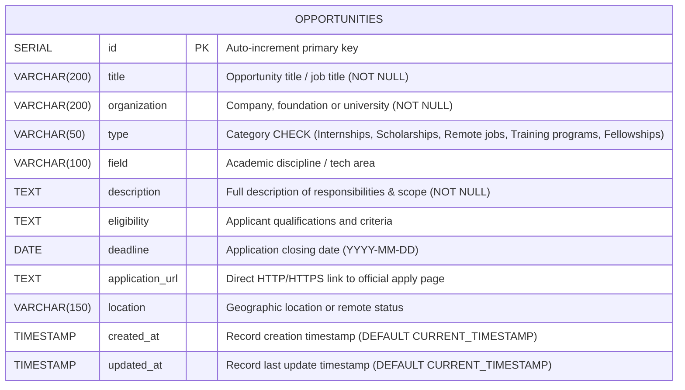

# Database Design Specification
## Project: Menged (መንገድ) — Opportunity Discovery Platform

**Database Name:** `menged_db`  
**Relational Database Engine:** PostgreSQL  
**Verified Version:** PostgreSQL 17.11  
**Default Port:** `5432`  
**Milestone:** Codveda Full-Stack Development Internship — Level 1 (Basic)  
**Schema Definition File:** [`Level-1-Basic/Task-2-REST-API/database/schema.sql`](../Level-1-Basic/Task-2-REST-API/database/schema.sql)  
**Seed Data File:** [`Level-1-Basic/Task-2-REST-API/database/seed.sql`](../Level-1-Basic/Task-2-REST-API/database/seed.sql)  
**Status:** Implemented & Verified in PostgreSQL  

---

## 1. Database Overview

The Menged platform relies on a PostgreSQL relational database system. The database is designed to provide high-performance querying, strict data integrity, and structured classification for higher-education opportunity listings across Ethiopia.

In the **Level 1 (Basic)** milestone, the data architecture focuses on the core entity of the system: **`opportunities`**. All opportunity discovery, search, filtering, and community submission flows operate against this single, optimized table.



---

## 2. Table Specifications: `opportunities`

The `opportunities` table serves as the primary data store for all opportunity listings on the platform.

### 2.1 Table Summary
* **Table Name:** `opportunities`
* **Primary Key:** `id` (Auto-incrementing integer sequence)
* **Storage Engine:** PostgreSQL Heap
* **Total Columns:** 12
* **Row Cardinality (Seed):** 5 initial demonstration records across all 5 categories

### 2.2 Detailed Column Dictionary

| Column Name | PostgreSQL Data Type | Nullable | Default Value | Description & Constraints |
|---|---|:---:|---|---|
| `id` | `SERIAL` | **NO** | `nextval('opportunities_id_seq')` | **Primary Key.** Unique integer identifier assigned automatically upon row creation. |
| `title` | `VARCHAR(200)` | **NO** | None | Full title of the opportunity (e.g., *"Junior Software Engineering Internship"*). Maximum length 200 characters. |
| `organization` | `VARCHAR(200)` | **NO** | None | Name of the institution, university, tech firm, or foundation providing the opening. |
| `type` | `VARCHAR(50)` | **NO** | None | Opportunity classification. Enforced by database `CHECK` constraint to one of five valid values. |
| `field` | `VARCHAR(100)` | **YES** | `NULL` | Academic discipline or technical domain (e.g., *"Software Engineering"*, *"Artificial Intelligence"*, *"Cloud Computing"*). |
| `description` | `TEXT` | **NO** | None | Comprehensive overview of the opportunity, duties, syllabus, or award benefits. |
| `eligibility` | `TEXT` | **YES** | `NULL` | Specific qualifications, educational level, GPA benchmarks, or graduation status required for applicants. |
| `deadline` | `DATE` | **YES** | `NULL` | Application closing date in `YYYY-MM-DD` format. Used for deadline proximity sorting. |
| `application_url` | `TEXT` | **YES** | `NULL` | Verified external URL directing the applicant to the original application portal or form. |
| `location` | `VARCHAR(150)` | **YES** | `NULL` | Physical or remote workplace/study location (e.g., *"Addis Ababa, Ethiopia"*, *"Remote (Ethiopia)"*). |
| `created_at` | `TIMESTAMP` | **YES** | `CURRENT_TIMESTAMP` | System timestamp recorded when the row is first inserted. |
| `updated_at` | `TIMESTAMP` | **YES** | `CURRENT_TIMESTAMP` | System timestamp recorded when the row is updated. |

---

## 3. Database Constraints and Rules

### 3.1 Primary Key Constraint
```sql
CONSTRAINT opportunities_pkey PRIMARY KEY (id)
```
Guarantees uniqueness and establishes an underlying clustered B-Tree index for $O(1)$ direct primary key lookups.

### 3.2 Category `CHECK` Constraint
To prevent data contamination and preserve consistent frontend categorization, the `type` column is restricted by a database-level `CHECK` constraint:

```sql
CHECK (type IN (
    'Internships',
    'Scholarships',
    'Remote jobs',
    'Training programs',
    'Fellowships'
))
```

If an insert or update query specifies an unauthorized value (e.g., `'Full-time'`, `'Contract'`, or lowercase `'internship'`), PostgreSQL raises error code `23514` (`check_violation`), which the backend error middleware intercepts and translates to HTTP `400 Bad Request`.

### 3.3 Mandatory (`NOT NULL`) Constraints
The following four columns are strictly enforced as non-nullable:
* `title`: An opportunity cannot exist without an identifiable title.
* `organization`: An opportunity must be attributed to an entity.
* `type`: An opportunity must belong to one of the 5 standard categories.
* `description`: An opportunity must contain explanatory text.

---

## 4. Performance Indexes

To support rapid filtering and search across large opportunity datasets, three specialized single-column B-Tree indexes are defined:

```sql
-- 1. Index on Category / Type
CREATE INDEX idx_opportunities_type ON opportunities(type);

-- 2. Index on Academic Discipline / Field
CREATE INDEX idx_opportunities_field ON opportunities(field);

-- 3. Index on Application Deadline
CREATE INDEX idx_opportunities_deadline ON opportunities(deadline);
```

### Index Utilization Rationale
1. **`idx_opportunities_type`:** Optimizes high-frequency queries when users select category filter pills (`WHERE type = 'Internships'`).
2. **`idx_opportunities_field`:** Accelerates discipline matching using PostgreSQL's B-Tree pattern matching (`WHERE field ILIKE 'Software%'`).
3. **`idx_opportunities_deadline`:** Enables efficient sorting for opportunities approaching expiration (`ORDER BY deadline ASC`).

---

## 5. Sample Records (Verified Seed Data)

The following 5 demonstration records are seeded from `Level-1-Basic/Task-2-REST-API/database/seed.sql` to represent each of the supported categories:

| ID | Title | Organization | Type | Field | Deadline | Location |
|:---:|---|---|---|---|:---:|---|
| **1** | Demonstration: Junior Software Engineering Internship | TechEthio Innovations | `Internships` | Software Engineering | 2026-12-31 | Addis Ababa, Ethiopia |
| **2** | Demonstration: Graduate STEM Excellence Scholarship | Ethiopian Education Support Initiative | `Scholarships` | Computer Science & Data Science | 2026-11-30 | Addis Ababa, Ethiopia (Hybrid) |
| **3** | Demonstration: Junior Frontend Developer (Remote) | Global Pan-African Tech Labs | `Remote jobs` | Web Development | 2026-12-15 | Remote (Ethiopia) |
| **4** | Demonstration: Cloud Computing & DevOps Training Bootcamp | Horn of Africa Tech Academy | `Training programs` | Cloud Computing & DevOps | 2027-01-15 | Hawassa & Online, Ethiopia |
| **5** | Demonstration: African Tech Leadership & AI Fellowship | Future African Innovators Network | `Fellowships` | Artificial Intelligence & Public Policy | 2027-02-28 | Addis Ababa, Ethiopia |

---

## 6. Database Initialization and Management

### 6.1 Prerequisites
* PostgreSQL 17 server running locally on port `5432`.
* Superuser account (typically `postgres`).

### 6.2 Step-by-Step Initialization Commands

#### Step 1: Create the Database
In Windows PowerShell:
```powershell
psql -U postgres -c "CREATE DATABASE menged_db;"
```

#### Step 2: Execute Schema Definition
```powershell
psql -U postgres -d menged_db -f Level-1-Basic/Task-2-REST-API/database/schema.sql
```

#### Step 3: Seed Demonstration Data
```powershell
psql -U postgres -d menged_db -f Level-1-Basic/Task-2-REST-API/database/seed.sql
```

#### Step 4: Verify Table and Indexes
```powershell
psql -U postgres -d menged_db -c "\d opportunities"
```

Expected schema verification output:
```text
                                         Table "public.opportunities"
     Column      |          Type          | Collation | Nullable |                  Default                  
-----------------+------------------------+-----------+----------+-------------------------------------------
 id              | integer                |           | not null | nextval('opportunities_id_seq'::regclass)
 title           | character varying(200) |           | not null | 
 organization    | character varying(200) |           | not null | 
 type            | character varying(50)  |           | not null | 
 field           | character varying(100) |           |          | 
 description     | text                   |           | not null | 
 eligibility     | text                   |           |          | 
 deadline        | date                   |           |          | 
 application_url | text                   |           |          | 
 location        | character varying(150) |           |          | 
 created_at      | timestamp without time |           |          | CURRENT_TIMESTAMP
 updated_at      | timestamp without time |           |          | CURRENT_TIMESTAMP
Indexes:
    "opportunities_pkey" PRIMARY KEY, btree (id)
    "idx_opportunities_deadline" btree (deadline)
    "idx_opportunities_field" btree (field)
    "idx_opportunities_type" btree (type)
Check constraints:
    "opportunities_type_check" CHECK (type::text = ANY (ARRAY['Internships'::character varying, 'Scholarships'::character varying, 'Remote jobs'::character varying, 'Training programs'::character varying, 'Fellowships'::character varying]::text[]))
```

---

## 7. Current Database Limitations (Level 1)

1. **Absence of Foreign Keys:** Because Level 1 does not implement user accounts, `opportunities` does not link to a `users` or `creators` table via foreign keys.
2. **Single-Table Architecture:** Tracking statuses (*Saved*, *Applied*), user profiles, and application documents are not supported in the database at this milestone.
3. **No Full-Text Search Vector:** Search uses standard `ILIKE %query%` pattern matching. A dedicated PostgreSQL `tsvector` and GIN index are planned for Level 2/3.
4. **No Soft Deletion:** `DELETE` queries physically remove records via SQL `DELETE FROM opportunities WHERE id = $1`. Soft deletion (`deleted_at TIMESTAMP`) will be added in Level 2.

---

## 8. Planned Database Improvements (Level 2 & Level 3)

In upcoming milestones, the Menged database will expand into a multi-table relational schema supporting user workspaces, application tracking, document metadata, and moderation queues.

```mermaid
erDiagram
    USERS ||--o{ PROFILES : "has one"
    USERS ||--o{ APPLICATIONS : "submits"
    USERS ||--o{ DOCUMENTS : "uploads"
    USERS ||--o{ SAVED_OPPORTUNITIES : "bookmarks"
    
    OPPORTUNITIES ||--o{ APPLICATIONS : "receives"
    OPPORTUNITIES ||--o{ SAVED_OPPORTUNITIES : "referenced in"
    
    USERS {
        UUID id PK
        VARCHAR(100) email UK
        VARCHAR(255) password_hash
        VARCHAR(50) role "student | admin | reviewer"
        TIMESTAMP created_at
    }

    PROFILES {
        UUID id PK
        UUID user_id FK
        VARCHAR(150) full_name
        VARCHAR(150) university
        VARCHAR(100) major
        INTEGER graduation_year
        NUMERIC(3,2) gpa
        TEXT bio
    }

    OPPORTUNITIES {
        SERIAL id PK
        VARCHAR(200) title
        VARCHAR(200) organization
        VARCHAR(50) type
        VARCHAR(100) field
        TEXT description
        DATE deadline
        VARCHAR(50) status "pending | approved | archived"
    }

    APPLICATIONS {
        UUID id PK
        UUID user_id FK
        INTEGER opportunity_id FK
        VARCHAR(50) stage "Saved | Applied | Interview | Accepted | Rejected"
        DATE applied_date
        TEXT notes
    }

    DOCUMENTS {
        UUID id PK
        UUID user_id FK
        VARCHAR(100) document_type "resume | transcript | cover_letter"
        VARCHAR(255) file_path
        INTEGER file_size
        TIMESTAMP uploaded_at
    }

    SAVED_OPPORTUNITIES {
        UUID id PK
        UUID user_id FK
        INTEGER opportunity_id FK
        TIMESTAMP saved_at
    }
```
