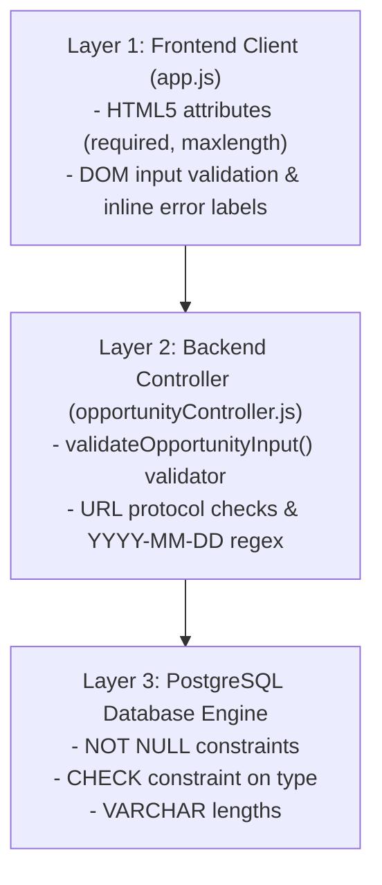

# Opportunity Data Standard Specification
## Project: Menged (መንገድ) — Opportunity Discovery Platform

**Specification Name:** Menged Opportunity Data Standard (MODS)  
**Standard Version:** 1.0.0  
**Status:** Implemented & Enforced  
**Applicability:** REST API Payloads, PostgreSQL Relational Storage, Frontend Data Bindings  

---

## 1. Purpose of the Data Standard

A primary technical problem addressed by **Menged** is the extreme heterogeneity of opportunity notices across Ethiopia. When collecting announcements from disparate external channels (Telegram, university boards, company career sites, international portals):
* One organization terms the deadline *"Closing Date"*, another *"Application Deadline"*, and a third omits it entirely.
* One listing describes candidate requirements in five paragraphs, while another provides only a Telegram handle.
* External links are often broken, redirected, or point to generic homepages rather than direct application forms.

The **Menged Opportunity Data Standard (MODS)** establishes an authoritative, predictable data dictionary. Every opportunity ingested, stored, or served by Menged must conform strictly to these field definitions, validation boundaries, and serialization formats.

---

## 2. Opportunity Entity Definition

An **Opportunity** represents a discrete, actionable opening for higher-education students, recent graduates, or aspiring professionals. It must contain sufficient information for an applicant to assess their eligibility, understand responsibilities, note deadlines, and navigate directly to the verified submission channel.

```
+-----------------------------------------------------------------------------------------+
|                                  OPPORTUNITY ENTITY                                     |
+-------------------+--------------------+-----------+------------------------------------+
| Field Name        | Storage Type       | Mandatory | Primary Function                   |
+-------------------+--------------------+-----------+------------------------------------+
| id                | Integer (SERIAL)   | YES (Auto)| Global unique record identifier    |
| title             | String (Max 200)   | YES       | Descriptive name of the opening    |
| organization      | String (Max 200)   | YES       | Entity offering the opportunity    |
| type              | Enum / String(50)  | YES       | Standardized classification        |
| field             | String (Max 100)   | NO        | Academic discipline / domain       |
| description       | Text (Arbitrary)   | YES       | Duties, benefits & syllabus        |
| eligibility       | Text (Arbitrary)   | NO        | Qualifications & criteria          |
| deadline          | ISO Date           | NO        | Application cutoff date            |
| application_url   | Validated URI/URL  | NO        | Verified outbound application link |
| location          | String (Max 150)   | NO        | Workplace or physical location     |
| created_at        | ISO Timestamp      | YES (Auto)| Record insertion timestamp         |
| updated_at        | ISO Timestamp      | YES (Auto)| Record modification timestamp      |
+-------------------+--------------------+-----------+------------------------------------+
```

---

## 3. Standard Field Dictionary

### 3.1 Required (Mandatory) Fields

#### 1. `title`
* **Data Type:** String (UTF-8)
* **Maximum Length:** 200 characters
* **Validation Rule:** Must be a non-empty string after trimming whitespace (`title.trim().length > 0`).
* **Convention:** Capitalize words appropriately (e.g., *"Junior Backend Developer Internship"*, not *"junior backend"* or all-caps). Do not prepend unnecessary prefixes like *"URGENT"* or *"APPLY NOW"*.

#### 2. `organization`
* **Data Type:** String (UTF-8)
* **Maximum Length:** 200 characters
* **Validation Rule:** Non-empty string after trimming.
* **Convention:** Use the official registered name of the company, university, or NGO (e.g., *"Ethio Telecom Labs"*, *"Addis Ababa University"*, *"African Development Bank"*).

#### 3. `type`
* **Data Type:** Enum String (Exact Match)
* **Maximum Length:** 50 characters
* **Validation Rule:** Must strictly match one of the 5 authorized values defined in Section 4. Case-sensitive.

#### 4. `description`
* **Data Type:** Text
* **Minimum Length:** Typically at least 20 characters for meaningful context.
* **Validation Rule:** Non-empty string after trimming.
* **Convention:** Provide a clear, structured summary covering: (a) what the role/program entails, (b) key learning outcomes or deliverables, and (c) any financial stipends or benefits.

### 3.2 Optional (Nullable) Fields

#### 5. `field`
* **Data Type:** String
* **Maximum Length:** 100 characters
* **Default Value:** `null`
* **Convention:** Represents the relevant academic discipline or tech area (e.g., *"Software Engineering"*, *"Data Science & AI"*, *"Cloud Computing"*, *"Electrical Engineering"*).

#### 6. `eligibility`
* **Data Type:** Text
* **Default Value:** `null`
* **Convention:** Plain-text description of candidate requirements. E.g., *"Enrolled in final year of BSc in Computer Science or Software Engineering with a minimum cumulative GPA of 3.2."*

#### 7. `deadline`
* **Data Type:** Date (ISO 8601 string `YYYY-MM-DD`)
* **Default Value:** `null` (Represents rolling applications or unspecified deadlines)
* **Validation Rule:** Must strictly adhere to regex `/^\d{4}-\d{2}-\d{2}$/` and parse to a valid calendar date.

#### 8. `application_url`
* **Data Type:** Text / URL String
* **Default Value:** `null`
* **Validation Rule:** Must parse as a valid URL beginning with `http://` or `https://`. Generic domain roots (`https://google.com`) are discouraged; prefer direct application landing pages.

#### 9. `location`
* **Data Type:** String
* **Maximum Length:** 150 characters
* **Default Value:** `null`
* **Convention:** City and Country, or Remote designation (e.g., *"Addis Ababa, Ethiopia"*, *"Remote (Ethiopia)"*, *"Hawassa & Online"*).

---

## 4. The 5 Standard Category Classifications

Every opportunity on Menged belongs to exactly one category:

| Category Value | Description | Typical Target Audience | Examples |
|---|---|---|---|
| **`Internships`** | Practical, temporary work experiences designed for current students or fresh graduates to gain industry skills. | 3rd/4th-year university undergraduates and recent graduates (< 1 year). | Summer software engineering internships, graphic design apprenticeships. |
| **`Scholarships`** | Financial grants or tuition waivers supporting academic degree completion. | High-achieving undergraduates, master's candidates, and doctoral researchers. | Full master's degree scholarships, research grants, tuition stipends. |
| **`Remote jobs`** | Full-time or part-time paid employment allowing remote work from Ethiopia for global or regional employers. | Graduates and junior professionals with reliable internet connectivity. | Junior React developer, remote technical support specialist, QA analyst. |
| **`Training programs`** | Structured bootcamps, workshops, and intensive courses focused on rapid skill acquisition. | Students seeking career transitions or upskilling in high-demand domains. | 8-week Cloud/DevOps bootcamp, mobile app development cohorts. |
| **`Fellowships`** | Prestigious programs combining project funding, mentorship, and professional network development. | Young researchers, technical leaders, and social innovators. | AI for Social Good fellowship, Young African Leadership Initiative. |

---

## 5. Validation Rules (Client and Server Enforcement)

Data integrity is enforced at three distinct layers:



### Server Validation Matrix (`validateOpportunityInput`)
```javascript
// Validation logic implemented in opportunityController.js
const validateOpportunityInput = (data, isUpdate = false) => {
  const errors = [];
  // 1. Title validation
  if (!data.title || data.title.trim().length === 0) {
    errors.push('Title is required and must be a non-empty string.');
  } else if (data.title.trim().length > 200) {
    errors.push('Title cannot exceed 200 characters.');
  }

  // 2. Organization validation
  if (!data.organization || data.organization.trim().length === 0) {
    errors.push('Organization is required and must be a non-empty string.');
  } else if (data.organization.trim().length > 200) {
    errors.push('Organization cannot exceed 200 characters.');
  }

  // 3. Category enum validation
  if (!VALID_TYPES.includes(data.type)) {
    errors.push(`Type is required and must be one of: ${VALID_TYPES.join(', ')}.`);
  }

  // 4. Description validation
  if (!data.description || data.description.trim().length === 0) {
    errors.push('Description is required and must be a non-empty string.');
  }

  // 5. Deadline date validation (optional field)
  if (data.deadline && !/^\d{4}-\d{2}-\d{2}$/.test(data.deadline)) {
    errors.push('Deadline must be a valid date in YYYY-MM-DD format.');
  }

  // 6. Application URL validation (optional field)
  if (data.application_url) {
    try {
      const u = new URL(data.application_url);
      if (u.protocol !== 'http:' && u.protocol !== 'https:') throw new Error();
    } catch (_) {
      errors.push('Application URL must be a valid HTTP or HTTPS URL.');
    }
  }

  return errors;
};
```

---

## 6. Real-World JSON Examples (Matching Implemented API)

### Example 1: Internship Opportunity Payload
```json
{
  "title": "Junior Backend Engineering Internship",
  "organization": "Ethio Telecom Innovation Labs",
  "type": "Internships",
  "field": "Software Engineering",
  "description": "A 3-month paid internship focusing on Node.js, Express microservices, and PostgreSQL database performance optimization. Interns work alongside senior engineers on production APIs.",
  "eligibility": "Final-year undergraduate student in Computer Science or Software Engineering with familiarity in JavaScript, SQL, and Git.",
  "deadline": "2026-12-31",
  "application_url": "https://example.com/careers/backend-internship",
  "location": "Addis Ababa, Ethiopia (Hybrid)"
}
```

### Example 2: Graduate Scholarship Payload
```json
{
  "title": "East Africa Graduate STEM Scholarship",
  "organization": "Pan-African Technology Foundation",
  "type": "Scholarships",
  "field": "Artificial Intelligence & Data Science",
  "description": "Full tuition waiver and monthly research stipend for Ethiopian graduates pursuing Master of Science degrees in Artificial Intelligence, Machine Learning, or Robotics.",
  "eligibility": "Graduated within the last 2 years from an accredited Ethiopian public university with a cumulative GPA of 3.6 or above. Strong academic record in mathematics.",
  "deadline": "2027-01-30",
  "application_url": "https://example.com/scholarships/stem-excellence",
  "location": "Addis Ababa & Regional Campuses"
}
```

### Example 3: Minimal Valid Opportunity (Only Mandatory Fields)
```json
{
  "title": "Junior Web Content Associate",
  "organization": "Horn Tech Media",
  "type": "Remote jobs",
  "description": "Remote entry-level position assisting in curating, proofreading, and publishing educational articles and opportunity notices for Ethiopian youth."
}
```

---

## 7. Data Quality & Duplicate Prevention Guidelines

To maintain platform credibility and trust, contributors and future scraper modules must follow these normalization rules:

1. **Title Deduplication:** Before submitting or inserting an opportunity, verify whether an active listing already exists with identical `title` and `organization`.
2. **Whitespace Trimming:** All strings must be trimmed of leading and trailing whitespace before persistence.
3. **URL Sanitization:** Strip tracking query parameters (e.g., `?utm_source=telegram&utm_medium=channel`) to keep application links permanent and clean.
4. **Deadline Verification:** Past deadlines must not be published as active listings. Opportunities whose `deadline < CURRENT_DATE` are tagged as expired.

---

## 8. Future Schema Extensions (Planned for Level 2 & Level 3)

| Proposed Field | Target Type | Purpose | Planned Milestone |
|---|---|---|:---:|
| `status` | Enum (`pending`, `published`, `archived`) | Moderation status for community submissions | Level 2 |
| `submitted_by` | UUID (Foreign Key to `users`) | Tracks author identity | Level 2 |
| `is_verified` | Boolean (`DEFAULT false`) | Verification badge for employer-certified listings | Level 2 |
| `compensation` | String(100) (e.g., *"Paid ($300/mo)"*, *"Unpaid"*) | Transparent financial disclosure | Level 2 |
| `experience_level` | Enum (`intern`, `entry`, `associate`) | Clear career stage targeting | Level 2 |
| `source_url` | Text | Original URL where vacancy was scraped | Level 3 |
| `raw_hash` | Char(64) (SHA-256) | Automated duplicate detection across web scrapers | Level 3 |
