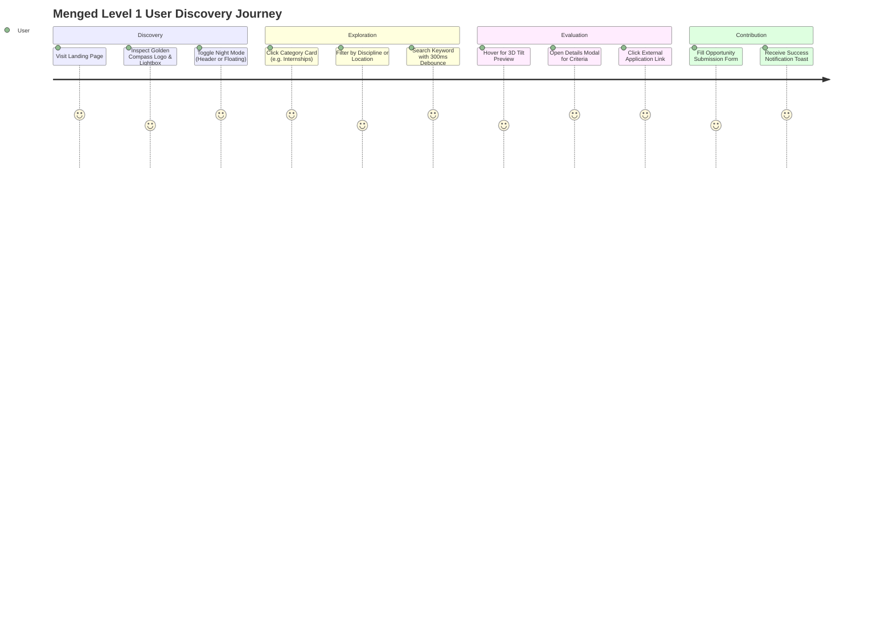

# Software Requirements Specification (SRS)
## Project: Menged (መንገድ) — Opportunity Discovery Platform

**Platform Name:** Menged (መንገድ — "Path" or "Way" in Amharic)  
**Development Program:** Codveda Full-Stack Development Internship  
**Current Milestone:** Level 1 (Basic)  
**Document Version:** 1.0.0  
**Target Region:** Ethiopia (with global opportunity access)  
**Primary Users:** Ethiopian University Students, Recent Graduates, and Early-Career Professionals  
**Lead Developer:** Etsegenet Amsalu (Haleta)  
**Repository:** [https://github.com/haleta-e/codveda-fullstack-internship](https://github.com/haleta-e/codveda-fullstack-internship)

---

## 1. Document Overview and Purpose

This Software Requirements Specification (SRS) defines the functional and non-functional requirements, constraints, user journeys, and architectural scope for the **Menged** platform. It provides a technical baseline for evaluators, developers, and stakeholders, detailing what has been built in the completed **Level 1 (Basic)** milestone and outlining the planned trajectory for **Level 2 (Intermediate)** and **Level 3 (Advanced)**.

---

## 2. Product Introduction and Vision

### 2.1 The Problem Statement
Higher-education students and recent graduates in Ethiopia face severe information fragmentation when seeking academic and professional advancement. Career notices, internships, international scholarships, remote technical roles, bootcamps, and fellowships are scattered inconsistently across Telegram channels, Facebook groups, university noticeboards, and institutional websites. 

This causes critical problems:
* **Information Inconsistency:** Key criteria (deadlines, academic eligibility, location, official application links) are frequently omitted, ambiguous, or expired.
* **Missed Deadlines:** Students discover life-changing scholarships and internships after deadlines have closed.
* **Scam Vulnerability:** Unverified opportunities expose students to fraudulent schemes and unaccredited fees.
* **No Unified Management:** Students lack a structured mechanism to explore, track, and prepare for applications systematically.

### 2.2 The Product Vision
**Menged (መንገድ)** serves as a centralized, standardized, and verified opportunity gateway. It bridges the gap between ambitious Ethiopian talent and real-world opportunities by standardizing disparate notices into clean, actionable listings. 

The core user journey evolves through distinct phases:
$$\text{Discover} \longrightarrow \text{Evaluate} \longrightarrow \text{Prepare} \longrightarrow \text{Apply} \longrightarrow \text{Track} \longrightarrow \text{Grow}$$

---

## 3. Scope and Operating Boundaries

### 3.1 Implemented Scope (Level 1 — Basic)
* A high-performance, responsive single-page discovery portal built in semantic HTML5, modern CSS3, and Vanilla JavaScript (ES6+).
* An Express.js REST API providing full CRUD access over the primary `Opportunity` entity with PostgreSQL persistence.
* Real-time search with a 300ms debounce and multi-factor filtering (Category, Academic Discipline, Location, and Deadline Sorting).
* Dual-theme support (Vibrant Emerald Canvas and Obsidian Night Mode) with outside navbar controls, a persistent floating theme switcher, and `localStorage` persistence.
* An interactive 3D perspective tilt effect on cards and hero parallax animation.
* A read-only Opportunity Details modal with verified eligibility criteria and direct outbound links.
* A community-driven opportunity submission form connected via HTTP `POST` to the REST API.
* Resilient offline/demonstration fallback when backend services are disconnected.

### 3.2 Out-of-Scope (Level 1 Explicit Boundaries)
* User account registration, login, JWT token issuance, and password hashing (Level 2).
* Personal user workspaces, saved bookmarks, and application tracking stages (Level 2).
* Document storage (CVs, cover letters, transcripts) and file upload backends (Level 2).
* Administrative role-based access control (RBAC) and submission moderation dashboards (Level 2/3).
* Automated web crawlers, RSS ingestors, and AI-driven normalization pipelines (Level 3).
* Third-party frontend frameworks (React, Vue, Angular, Bootstrap, Tailwind) — explicitly constrained to Vanilla JavaScript and pure CSS3.

---

## 4. User Personas and Target Audience

```
+-------------------------------------------------------------------------------------------------+
|                                        TARGET PERSONAS                                          |
+------------------------------------+------------------------------------+-----------------------+
| Persona A: Graduating Student      | Persona B: Recent Graduate         | Persona C: Contributor|
| (Abebe, Computer Engineering)      | (Selam, Information Systems)       | (Tech Lead / Mentor)  |
+------------------------------------+------------------------------------+-----------------------+
| Needs:                             | Needs:                             | Needs:                |
| - Finds 3-month summer internships | - Finds entry-level remote tech    | - Submits verified    |
| - Filters by Addis Ababa/hybrid    |   roles or international master's  |   openings for junior |
| - Clear eligibility & deadlines    |   scholarships                     |   talent              |
| - Direct application links         | - Fast search across disciplines   | - Fast community form |
+------------------------------------+------------------------------------+-----------------------+
```

---

## 5. Main User Journeys



### Journey 1: Public Opportunity Discovery (Implemented)
1. User lands on the Menged portal (`index.html`).
2. Reviews the Hero section with 3D floating preview cards.
3. Selects an opportunity category (e.g., *Internships*) or uses the debounced search bar.
4. Refines results by discipline (e.g., *Software Engineering*) and location (e.g., *Addis Ababa*).
5. Hovers over cards to evaluate key tags, organization initials, and deadlines.
6. Clicks *"View Details"* to inspect comprehensive criteria and clicks the official application link.

### Journey 2: Community Opportunity Contribution (Implemented)
1. User navigates to Section 05 (*"Submit a Verified Opportunity"*).
2. Completes required fields: Title, Organization, Category, Description, and optional metadata.
3. Submits the form; client-side validation verifies input integrity before dispatching an HTTP `POST` request to `/api/opportunities`.
4. The system returns an HTTP 201 Created response, displays a success toast notification, and dynamically prepends the record to the active stream.

### Journey 3: Personal Workspace & Application Tracking (Planned — Level 2)
1. Registered user logs into their personal workspace.
2. Saves opportunities to a personal dashboard (*Saved*, *Applied*, *Interviewing*, *Offered*, *Archived*).
3. Uploads tailored CVs and cover letters linked directly to tracked opportunities.
4. Receives automated deadline alerts.

### Journey 4: Administrative Moderation & Ingestion (Planned — Level 2/3)
1. Administrator logs into the Menged management console.
2. Reviews community-submitted listings in a moderation queue.
3. Approves, edits, or rejects submissions prior to public publication.

---

## 6. Functional Requirements

### 6.1 Implemented Functional Requirements (Level 1)

| Requirement ID | Module | Description | Implementation Status |
|---|---|---|:---:|
| **FR-001** | Brand Identity | The system shall display the official bilingual brand header (MENGED / መንገድ) with a clipped circular compass logo. | **Implemented** |
| **FR-002** | Brand Lightbox | Clicking the navbar logo shall open an interactive, accessible modal showing the high-resolution brand asset. | **Implemented** |
| **FR-003** | Night Mode Header | The system shall provide a theme switcher outside the navigation drawer in the header to toggle between Emerald and Obsidian modes. | **Implemented** |
| **FR-004** | Night Mode Floating | The system shall provide a persistent floating action pill at the bottom-right corner of the screen for theme switching. | **Implemented** |
| **FR-005** | Theme Persistence | The active theme selection shall persist across browser sessions using `localStorage` under key `menged-theme`. | **Implemented** |
| **FR-006** | 3D Hero Parallax | The system shall animate 3D floating preview cards in the hero section responding to desktop cursor coordinates. | **Implemented** |
| **FR-007** | Category Navigation | The system shall provide 5 category cards (*Internships, Scholarships, Remote jobs, Training programs, Fellowships*) that filter the stream and smooth-scroll to `#discover`. | **Implemented** |
| **FR-008** | Real-Time Search | The search input shall execute queries against `title`, `organization`, and `description` with a **300ms debounce delay**. | **Implemented** |
| **FR-009** | Category Pills | The stream shall provide pill filters (*All, Internships, Scholarships, Remote jobs, Training programs, Fellowships*) with active state styling. | **Implemented** |
| **FR-010** | Discipline Filter | The system shall provide a dropdown filter to refine opportunities by academic discipline/tech field. | **Implemented** |
| **FR-011** | Location Filter | The system shall filter opportunities based on location (client-side in Level 1). | **Implemented** |
| **FR-012** | Result Sorting | The system shall sort records dynamically by *Newest First*, *Approaching Deadline*, and *Alphabetical (A-Z)*. | **Implemented** |
| **FR-013** | 3D Card Hover Tilt | Opportunity cards shall calculate mouse entry angles to tilt dynamically with 3D perspective transforms. | **Implemented** |
| **FR-014** | Opportunity Modal | Clicking *"View Details"* shall render an accessible modal with full description, eligibility, and outbound links. | **Implemented** |
| **FR-015** | Modal Escape Control | Modals shall close on `Escape` keypress, clicking the backdrop, or clicking the explicit close button. | **Implemented** |
| **FR-016** | Community Submission | The system shall provide a public form to submit opportunities to the backend via HTTP `POST /api/opportunities`. | **Implemented** |
| **FR-017** | Client Form Validation| The form shall enforce required fields (`title`, `organization`, `type`, `description`) and highlight errors inline. | **Implemented** |
| **FR-018** | Toast Alerts | The application shall render self-dismissing feedback toasts for submission successes, warnings, and errors. | **Implemented** |
| **FR-019** | Offline Resilience | If the Express API or PostgreSQL is unreachable, the frontend shall seamlessly fall back to local demonstration records. | **Implemented** |
| **FR-020** | Health Monitoring | The system shall query `GET /api/health` and display a real-time status pill (*Live PostgreSQL* vs. *Demonstration Mode*). | **Implemented** |
| **FR-021** | REST API Querying | The backend shall handle `GET /api/opportunities` with support for `?type=`, `?field=`, and `?search=` filters. | **Implemented** |
| **FR-022** | REST Opportunity CRUD | The backend shall implement full CRUD: `GET /:id`, `POST /`, `PUT /:id`, and `DELETE /:id`. | **Implemented** |
| **FR-023** | SQL Sanitization | All SQL interactions shall use parameterized queries (`$1`, `$2`, etc.) via `pg.Pool` to prevent SQL injection. | **Implemented** |
| **FR-024** | Centralized Errors | The backend shall route uncaught exceptions through an error middleware mapping PostgreSQL codes to standard HTTP statuses. | **Implemented** |
| **FR-025** | Database Check Rules | The database shall enforce a `CHECK` constraint restricting `type` to the 5 valid opportunity classifications. | **Implemented** |

### 6.2 Planned Functional Requirements (Level 2 & Level 3)

| Requirement ID | Module | Description | Target Milestone |
|---|---|---|:---:|
| **FR-101** | User Authentication | User registration and login utilizing hashed passwords (bcrypt) and signed JWT tokens in HTTP-only cookies. | Level 2 |
| **FR-102** | User Profile | Academic profiles storing university, field of study, graduation year, GPA, skills, and target career paths. | Level 2 |
| **FR-103** | Opportunity Bookmarks| Ability for authenticated users to bookmark/save opportunities to a personal collection. | Level 2 |
| **FR-104** | Application Tracker | Kanban-style or tabular application status tracking (*Saved, Applied, Interviewing, Accepted, Rejected*). | Level 2 |
| **FR-105** | Document Library | Secure upload and storage for PDF resumes, transcripts, and tailored cover letters. | Level 2 |
| **FR-106** | Submission Moderation| Administrative review queue allowing staff to approve, edit, or reject community-submitted listings before public display. | Level 2 |
| **FR-201** | Opportunity Collector| Automated web scrapers and RSS ingestion pipelines collecting opportunities from university and company job boards. | Level 3 |
| **FR-202** | Normalization Engine | AI/rule-based pipeline parsing unstructured vacancy notices into the standard Menged schema. | Level 3 |
| **FR-203** | Deadline Reminders | Automated email and Telegram notifications alerting users 7, 3, and 1 day prior to application deadlines. | Level 3 |
| **FR-204** | Match Scoring | Recommendation engine computing compatibility scores between user profiles and opportunity requirements. | Level 3 |

---

## 7. Non-Functional Requirements (NFR)

### 7.1 Usability and Accessibility
* **NFR-001 (Color Contrast):** All text elements shall meet WCAG 2.1 AA standards (minimum contrast ratio of 4.5:1 for normal text and 3:1 for large text) across both Light and Night modes.
* **NFR-002 (Reduced Motion):** All keyframe animations, 3D tilts, and parallax effects shall respect the user's OS-level `@media (prefers-reduced-motion: reduce)` settings.
* **NFR-003 (Mobile Responsiveness):** The interface shall render without horizontal scrolling or layout breakages across all viewport widths from 320px to 4K displays.

### 7.2 Performance and Efficiency
* **NFR-004 (Load Time):** The static frontend bundle (HTML, CSS, JS, SVG assets) shall achieve an initial paint under 1.2 seconds over simulated 3G connections.
* **NFR-005 (Debounce Throttling):** Keyword search execution shall be throttled with a 300ms debounce timer to limit server and DOM thrashing.
* **NFR-006 (Database Connection Pooling):** The backend shall utilize a managed connection pool (`pg.Pool`) configured with idle timeouts and automatic client release.
* **NFR-007 (Query Indexing):** Database indexes (`idx_opportunities_type`, `idx_opportunities_field`, `idx_opportunities_deadline`) shall ensure $O(\log n)$ query lookups.

### 7.3 Reliability and Resilience
* **NFR-008 (Graceful Degradation):** If the REST API or PostgreSQL service is unreachable, the frontend client shall handle network failures gracefully, presenting the demonstration dataset and displaying a non-blocking status badge.
* **NFR-009 (Credential Masking):** The backend error handler shall prevent database connection strings, passwords, and raw stack traces from leaking into client-facing JSON payloads.

### 7.4 Maintainability and Clean Architecture
* **NFR-010 (Framework Independence):** The Level 1 frontend shall contain zero third-party framework dependencies, ensuring high long-term maintainability.
* **NFR-011 (Modular Code Structure):** The backend code shall maintain strict separation of concerns across Configuration (`config/`), Routing (`routes/`), Controllers (`controllers/`), and Middleware (`middleware/`).

---

## 8. Technical Constraints and Assumptions

### 8.1 Constraints
1. **Academic/Internship Policy:** Adherence to Codveda Level 1 Basic guidelines: pure Vanilla JavaScript, HTML5, and CSS3 on the client; Node.js, Express, and PostgreSQL on the server.
2. **Database System:** PostgreSQL 17 running on standard port `5432`.
3. **Local Development Host:** Node.js Express server configured on `http://localhost:5000` with CORS enabled.

### 8.2 Assumptions
1. Users access the web application through modern standards-compliant browsers (Google Chrome, Mozilla Firefox, Microsoft Edge, Safari) supporting CSS Custom Properties and ES6+ modules.
2. Initial deployment operates on localhost for evaluation before migrating to managed cloud infrastructure in later milestones.

---

## 9. Current Technical Limitations

1. **Unauthenticated Submissions:** The Level 1 submission form transmits directly to `POST /api/opportunities` without requiring user authentication or administrative pre-moderation.
2. **Client-Side Location & Sorting:** In the Level 1 implementation, `type`, `field`, and `search` are filtered on the PostgreSQL backend, while location filtering and sorting are computed client-side in `app.js`.
3. **No File Uploads:** Application links are stored as URLs; PDF resumes cannot be uploaded to local storage or cloud buckets in Level 1.
4. **Single-Table Schema:** The current database contains a single primary table (`opportunities`). Relational schemas for user accounts and application tracking are deferred to Level 2.
