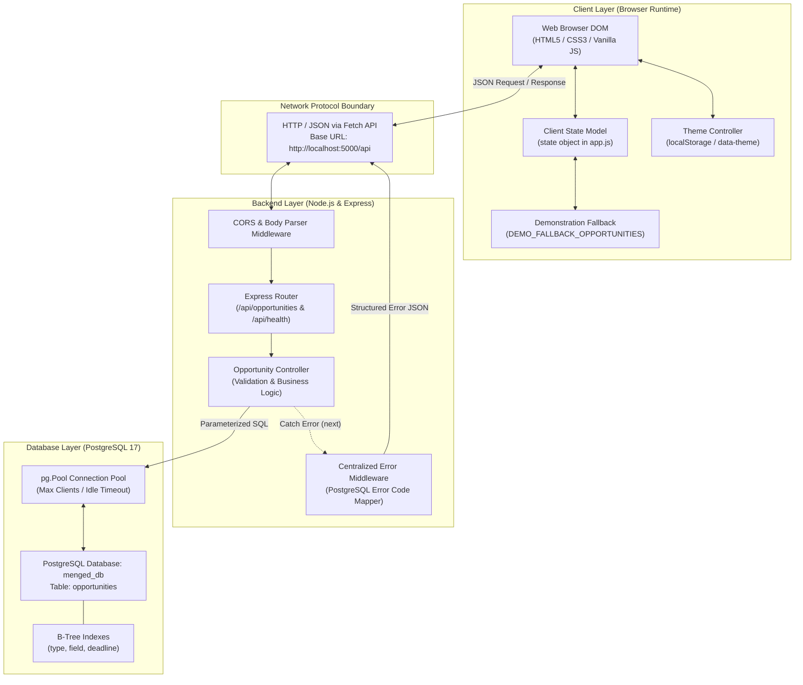
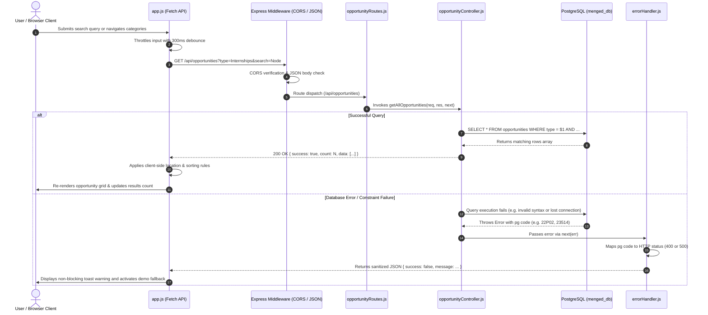
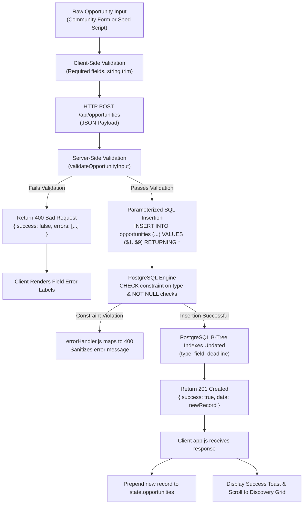
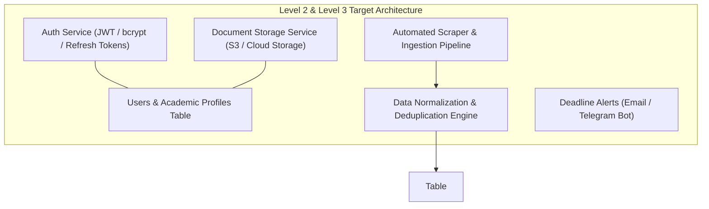

# System Architecture Specification
## Project: Menged (መንገድ) — Opportunity Discovery Platform

**Platform:** Menged (መንገድ)  
**Milestone:** Codveda Full-Stack Development Internship — Level 1 (Basic)  
**Document Version:** 1.0.0  
**Status:** Implemented & Verified  
**Primary Language/Stack:** HTML5, CSS3, Vanilla JavaScript, Node.js, Express.js, PostgreSQL 17  

---

## 1. System Overview

**Menged** is architectured as a decoupled client-server full-stack web application. The platform provides a responsive, accessible discovery interface for higher-education students in Ethiopia while maintaining a clean, modular Node.js/Express REST API backed by a relational PostgreSQL database.



---

## 2. Architectural Approach

The system follows the **Decoupled Three-Tier Architecture**:
1. **Presentation Tier (Frontend Client):** A lightweight Single-Page Application (SPA) constructed without external frameworks. It handles user events, DOM manipulation, client-side sorting, debounce timers, local storage synchronization, and 3D UI transforms.
2. **Application Tier (RESTful API Server):** An Express.js application designed following the **Controller-Service-Router** architectural pattern. It isolates routing, request validation, business rules, and error handling into distinct components.
3. **Data Tier (Relational Storage):** A PostgreSQL relational database utilizing ACID transactions, typed schemas, strict constraints, and performance indexes.

---

## 3. Technology Stack and Technical Specifications

| Layer | Component | Version / Specification | Technical Purpose |
|---|---|---|---|
| **Presentation** | HTML5 | Semantic W3C Standard | Page landmarks (`<header>`, `<nav>`, `<main>`, `<section>`, `<article>`, `<footer>`) |
| **Presentation** | CSS3 | Custom Properties Tokens | Color system, 3D perspective transforms, Glassmorphism blur, CSS Grid, Flexbox |
| **Presentation** | Vanilla JavaScript | ECMAScript 2022 (ES6+) | Event handlers, DOM injection, Async/Await Fetch API, Parallax logic |
| **Presentation** | Typography | Google Fonts | `Plus Jakarta Sans` (Headings), `Inter` (Body), `Noto Sans Ethiopic` (Amharic) |
| **Application** | Node.js | v24.18.0 | Server-side JavaScript runtime environment |
| **Application** | Express.js | v4.21.2 | HTTP routing, request parsing, and middleware pipeline |
| **Application** | CORS | v2.8.5 | Cross-Origin Resource Sharing headers for browser clients |
| **Application** | Dotenv | v16.4.7 | Environment variable encapsulation (`.env`) |
| **Data Access** | `pg` (node-postgres) | v8.13.1 | Managed client pooling (`pg.Pool`) and parameterized query execution |
| **Data Storage** | PostgreSQL | v17.11 | Relational database management system |

---

## 4. Frontend Architecture

The frontend application (`Level-1-Basic/Task-3-Frontend/`) is completely self-contained and operates within the browser runtime.

```
Task-3-Frontend/
├── assets/
│   └── logo.png              # High-resolution golden compass brand identity asset
├── css/
│   └── style.css             # Unified stylesheet (1,900+ lines, Design Tokens, Night Mode, 3D Transforms)
├── js/
│   └── app.js                # Core controller: State management, API integration, DOM rendering, UI events
├── documentation/
│   └── FRONTEND_DOCUMENTATION.md
├── screenshots/
│   └── README.md
└── index.html                # Semantic single-page HTML layout
```

### 4.1 Client State Model
The frontend state is centralized in an immutable-style reactive state object inside `app.js`:

```javascript
const state = {
  opportunities: [],           // Complete list of retrieved opportunity records
  filteredOpportunities: [],   // Active subset reflecting filters and search queries
  activeCategory: 'All',       // Category filter: 'All' | 'Internships' | 'Scholarships' | ...
  activeField: 'All',          // Academic discipline filter
  activeLocation: 'All',       // Geographic / remote filter (client-side)
  activeSort: 'newest',        // Sorting: 'newest' | 'deadline' | 'title'
  searchQuery: '',             // Real-time search string
  isBackendOnline: false,      // Dynamic health status flag
  searchDebounceTimer: null,   // 300ms window timeout ID
};
```

### 4.2 Theme & Lighting Architecture
The theme system uses CSS variables mapped under the root selector `:root` and overridden under `[data-theme="dark"]`.
* **Header Toggle Button:** Located in the navbar (`#theme-toggle`) outside the collapsing navigation drawer, ensuring accessibility across all devices.
* **Persistent Floating Toggle:** An accessible pill button (`#floating-theme-toggle`) pinned to the viewport bottom-right (`position: fixed; bottom: 1.75rem; right: 1.75rem; z-index: 999;`).
* **Synchronization:** State changes update `document.documentElement.setAttribute('data-theme', theme)` and synchronize both icons (`☀️` / `🌙`) and persist the string `'light'` or `'dark'` into `localStorage.getItem('menged-theme')`.

### 4.3 3D Perspective and Parallax
* **Hero 3D Floating Cards:** Animated using CSS keyframe oscillations (`@keyframes floatSlow`, `@keyframes floatMedium`, `@keyframes floatReverse`). Mouse movements on `#hero-3d-scene` calculate normalized X/Y offsets to drive smooth CSS `translate3d()` parallax.
* **Card 3D Hover Tilt:** Every `.opportunity-card` computes cursor entry coordinates relative to its bounding box center to dynamically apply `perspective(1000px) rotateX() rotateY() translateY(-6px)`.

---

## 5. Backend Architecture

The backend application (`Level-1-Basic/Task-2-REST-API/`) follows a clean, modular structure:

```
Task-2-REST-API/
├── src/
│   ├── config/
│   │   └── db.js                        # PostgreSQL connection pool configuration
│   ├── controllers/
│   │   └── opportunityController.js     # Request validation, SQL builders, and business logic
│   ├── middleware/
│   │   ├── errorHandler.js              # Centralized error handler and SQL code mapper
│   │   └── notFound.js                  # 404 handler for unmatched routes
│   ├── routes/
│   │   └── opportunityRoutes.js         # Endpoint declarations mapped to controllers
│   ├── app.js                           # Express application assembly & global middleware
│   └── server.js                        # HTTP listener entrypoint & startup health check
├── database/
│   ├── schema.sql                       # Table definitions, constraints, and indexes
│   └── seed.sql                         # Simulated demonstration records
├── tests/
│   └── Menged_API.postman_collection.json # 15 automated test scenarios
├── .env.example                         # Environment configuration template
├── package.json                         # Dependencies and NPM scripts
└── README.md
```

### 5.1 Route Mapping Table

| HTTP Method | Route Path | Controller Function | Description | Access |
|---|---|---|---|:---:|
| `GET` | `/api/health` | Inline handler | Returns server uptime, status, and system timestamp | Public |
| `GET` | `/` | Inline handler | Returns API welcoming notice and available endpoints | Public |
| `GET` | `/api/opportunities` | `getAllOpportunities` | Fetches opportunities with optional query filtering (`type`, `field`, `search`) | Public |
| `GET` | `/api/opportunities/:id` | `getOpportunityById` | Fetches a single opportunity by integer ID | Public |
| `POST` | `/api/opportunities` | `createOpportunity` | Validates input and inserts a new opportunity | Public |
| `PUT` | `/api/opportunities/:id` | `updateOpportunity` | Validates and updates all fields of an existing opportunity | Public |
| `DELETE` | `/api/opportunities/:id`| `deleteOpportunity` | Deletes an opportunity by integer ID (returns 204 No Content) | Public |

---

## 6. End-to-End Request-Response Lifecycle

The diagram below details the exact lifecycle of an HTTP request traversing the Menged architecture:



---

## 7. Opportunity Data Flow Architecture

The data lifecycle follows a standardized progression from initial input to persistent storage and presentation:



---

## 8. Database Architecture and Connection Management

### 8.1 Database Configuration (`src/config/db.js`)
Database connectivity is managed through `pg.Pool`, which maintains reusable client connections:

```javascript
const { Pool } = require('pg');
require('dotenv').config();

const pool = new Pool({
  user: process.env.DB_USER || 'postgres',
  host: process.env.DB_HOST || 'localhost',
  database: process.env.DB_NAME || 'menged_db',
  password: process.env.DB_PASSWORD || 'postgres',
  port: parseInt(process.env.DB_PORT || '5432', 10),
});
```

### 8.2 Entity Relationship
In Level 1, the database is intentionally designed as a high-performance single-entity architecture centered on `opportunities`:

```
+-----------------------------------------------------------+
|                      opportunities                        |
+-----------------------------------------------------------+
| id               SERIAL PRIMARY KEY                       |
| title            VARCHAR(200) NOT NULL                    |
| organization     VARCHAR(200) NOT NULL                    |
| type             VARCHAR(50) NOT NULL (CHECK constraint)  |
| field            VARCHAR(100)                             |
| description      TEXT NOT NULL                            |
| eligibility      TEXT                                     |
| deadline         DATE                                     |
| application_url  TEXT                                     |
| location         VARCHAR(150)                             |
| created_at       TIMESTAMP DEFAULT CURRENT_TIMESTAMP      |
| updated_at       TIMESTAMP DEFAULT CURRENT_TIMESTAMP      |
+-----------------------------------------------------------+
```

Indexes:
* `idx_opportunities_type` ON `opportunities(type)`
* `idx_opportunities_field` ON `opportunities(field)`
* `idx_opportunities_deadline` ON `opportunities(deadline)`

---

## 9. Error-Handling Architecture

The backend implements centralized error handling that translates internal runtime exceptions and PostgreSQL error codes into standard, predictable HTTP status codes while shielding the client from internal system details.

```mermaid
graph LR
    Exception["Runtime / Database Exception"] --> Catch["Controller try/catch block"]
    Catch --> Next["next(err)"]
    Next --> Middleware["errorHandler.js"]
    
    Middleware --> Switch{"Error Code Inspection"}
    Switch -->|"22P02 (Invalid Data Type)"| R400["400 Bad Request<br/>'Invalid data format provided.'"]
    Switch -->|"23502 (NOT NULL Violation)"| R400N["400 Bad Request<br/>'Required field missing.'"]
    Switch -->|"23514 (CHECK Constraint)"| R400C["400 Bad Request<br/>'Violates validation constraints.'"]
    Switch -->|"ECONNREFUSED / ENOTFOUND"| R500D["500 Database Unavailable<br/>'Unable to establish database connection.'"]
    Switch -->|SyntaxError (Malformed JSON)| R400J["400 Bad Request<br/>'Malformed JSON payload.'"]
    Switch -->|Generic / Unhandled| R500["500 Internal Error<br/>'A database error occurred.'"]
```

---

## 10. Security Architecture & Controls

### 10.1 SQL Injection Prevention
All database queries execute through parameterized inputs (`$1`, `$2`, `$3`):
```javascript
// SECURE: Parameters are safely separated from query text
const result = await db.query(
  'SELECT * FROM opportunities WHERE id = $1;',
  [id]
);
```

### 10.2 Cross-Site Scripting (XSS) Prevention
On the client side, dynamic data strings returned from the database or demonstration fallback are sanitized through an HTML entity encoder before insertion into template literals:
```javascript
function escapeHtml(str) {
  if (!str && str !== 0) return '';
  return String(str)
    .replace(/&/g, '&amp;')
    .replace(/</g, '&lt;')
    .replace(/>/g, '&gt;')
    .replace(/"/g, '&quot;')
    .replace(/'/g, '&#039;');
}
```

### 10.3 Credential Masking
The `src/middleware/errorHandler.js` module catches unhandled database errors and masks raw database connection strings, passwords, and server file paths, returning clean user-facing messages.

---

## 11. Current Architecture Limitations

1. **Unauthenticated Public API:** In the Level 1 milestone, all CRUD endpoints are public and do not enforce JSON Web Token (JWT) verification or role-based authorization.
2. **Client-Side Location Filtering & Sorting:** While `type`, `field`, and `search` are filtered on the PostgreSQL server, location matching and deadline sorting are processed on the client side in `app.js`.
3. **Local In-Memory Connection:** The system assumes a local PostgreSQL instance on `localhost:5432`. Cloud clustering and read replicas are not implemented.

---

## 12. Planned Architectural Improvements (Level 2 & Level 3)



* **Authentication & Authorization Service:** Implementation of bcrypt password hashing, access/refresh token pairs, and middleware gates (`verifyToken`, `requireAdmin`).
* **Relational Schema Expansion:** Introduction of foreign-key linked tables: `users`, `profiles`, `applications`, `documents`, and `saved_opportunities`.
* **External Scraper & Normalization Engine:** Microservices collecting unstructured opportunities from 20+ Ethiopian educational and employment websites, running them through regex and AI-driven normalization pipelines before staging them for administrative review.
